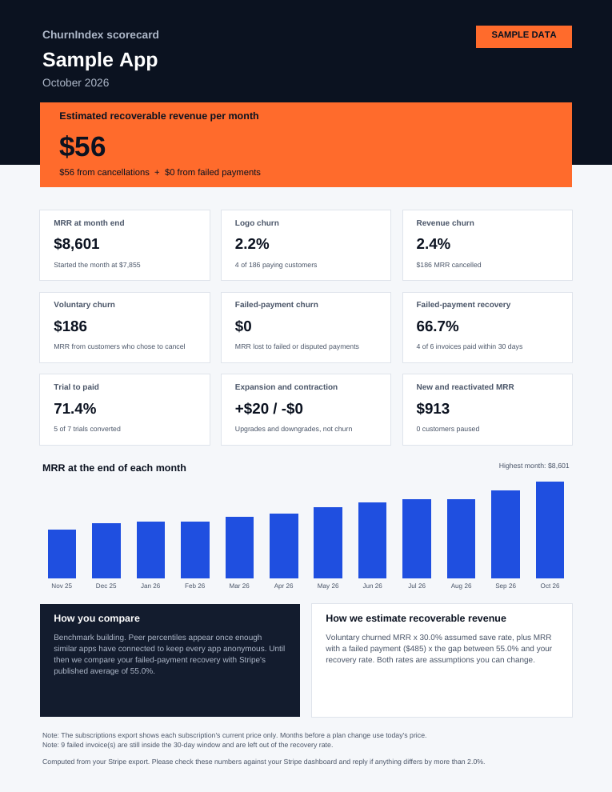

# ChurnIndex Phase 0: manual scorecards

A local script that turns a founder's Stripe CSV exports into a one-page PDF
scorecard you can email. Metric definitions follow section 8 of
`churnindex/CLAUDE.md`.



The picture above uses made-up sample data.

## One-time setup

From this folder (`churnindex/phase0`):

```bash
python3 -m venv .venv
./.venv/bin/pip install -r requirements.txt
```

## Try it on sample data

```bash
./.venv/bin/python make_sample_data.py
./.venv/bin/python -m scorecard sample_data/sample-app --name "Sample App" --month 2026-10 --as-of 2026-11-10 --sample
```

The PDF lands in `output/`.

## Scoring a real founder

1. **Ask the founder for these exports** from their Stripe dashboard. Ask for
   the full date range (up to 24 months) and all columns.

   | File name to save as | Where in Stripe | Needed? |
   |---|---|---|
   | `subscriptions.csv` | Billing, Subscriptions, Export | Yes |
   | `invoices.csv` | Billing, Invoices, Export | Yes |
   | `charges.csv` | Payments, Export (must include the Invoice ID column) | Strongly recommended: gives exact failed-payment timing |
   | `coupons.csv` | Product catalog, Coupons, Export | Only if they use coupons |
   | `fx.csv` | You make this one: columns `currency,month,rate` | Only if they bill in more than one currency |

2. **Put the files in a folder** under `data/`, for example `data/acme/`.
   The `data/` folder is never committed to git, because these files contain
   real customer information.

3. **Run it.** Note the founder's current MRR from their Stripe dashboard
   first, so the script can check our number:

   ```bash
   ./.venv/bin/python -m scorecard data/acme --name "Acme" --month 2026-10 --as-of 2026-11-12 --dashboard-mrr 18450
   ```

   - `--month` is the month to score. It defaults to last month.
   - `--as-of` is the date the founder exported the files.
   - `--dashboard-mrr` prints MATCH if we are within 2% of their Stripe number.

4. **Before you send the PDF:** if the MRR check says DIFFERENT, or a note
   on the PDF looks wrong, send the export to the engineer before emailing it.

5. **After scoring:** delete the founder's folder from `data/` once they have
   confirmed the numbers.

## If it says a column is missing

Stripe sometimes renames export columns. The error message names the field
and every spelling we accept. Add the new spelling to `ALIASES` in
`scorecard/loaders.py`, or ask Claude Code to do it.

## What the numbers mean

| On the PDF | Definition |
|---|---|
| Recoverable revenue | Voluntary churned MRR x 30%, plus failed-payment MRR x (55% minus your recovery rate). Both rates live in `scorecard/config.py`. |
| MRR | Active, non-trial subscriptions, normalized to monthly, after repeating and forever coupons, before tax |
| Logo churn | Paying customers at the start of the month who have no live paid subscription at month end |
| Revenue churn | MRR of fully cancelled subscriptions divided by MRR at month start |
| Voluntary or failed-payment | Stripe's cancellation reason; if missing, whether the final invoice was paid |
| Failed-payment recovery | Invoices with a failed attempt that were paid within 30 days |
| Trial to paid | Trials that ended in the month with a paid invoice afterward |

## Running the tests

```bash
./.venv/bin/pytest
```

Every metric and edge case from the brief has a test in `tests/test_metrics.py`.

## For the engineer review (brief section 11, item 1)

Judgment calls the brief did not spell out. Each is marked `DECISION` in
`scorecard/metrics.py`:

1. A customer who cancels and starts a new subscription in the same month is
   a reactivation, not churn. The MRR change counts as expansion or contraction.
2. Paused customers and customers on a 100% discount still have a live
   subscription, so they are not logo churn. Paused MRR is left out of MRR.
3. A trial cancelled early counts as ending on its cancel date.
4. Revenue churn counts every fully cancelled subscription in the month,
   including ones that started that month.
5. Cancellations with no Stripe reason and no invoices count as voluntary.

Known limits of CSV data:

- The subscriptions export shows only each subscription's current price, so
  months before a plan change use today's price. Extra rows with
  `item_start` and `item_end` columns can describe plan history.
- Without `charges.csv`, failed payments are estimated from invoice attempt
  counts.
- We assume the export's Amount column is the price per unit (multiplied by
  Quantity). Check this on the first seat-based account.
- Coupon start dates are not in the export, so discounts are assumed to start
  with the subscription.
